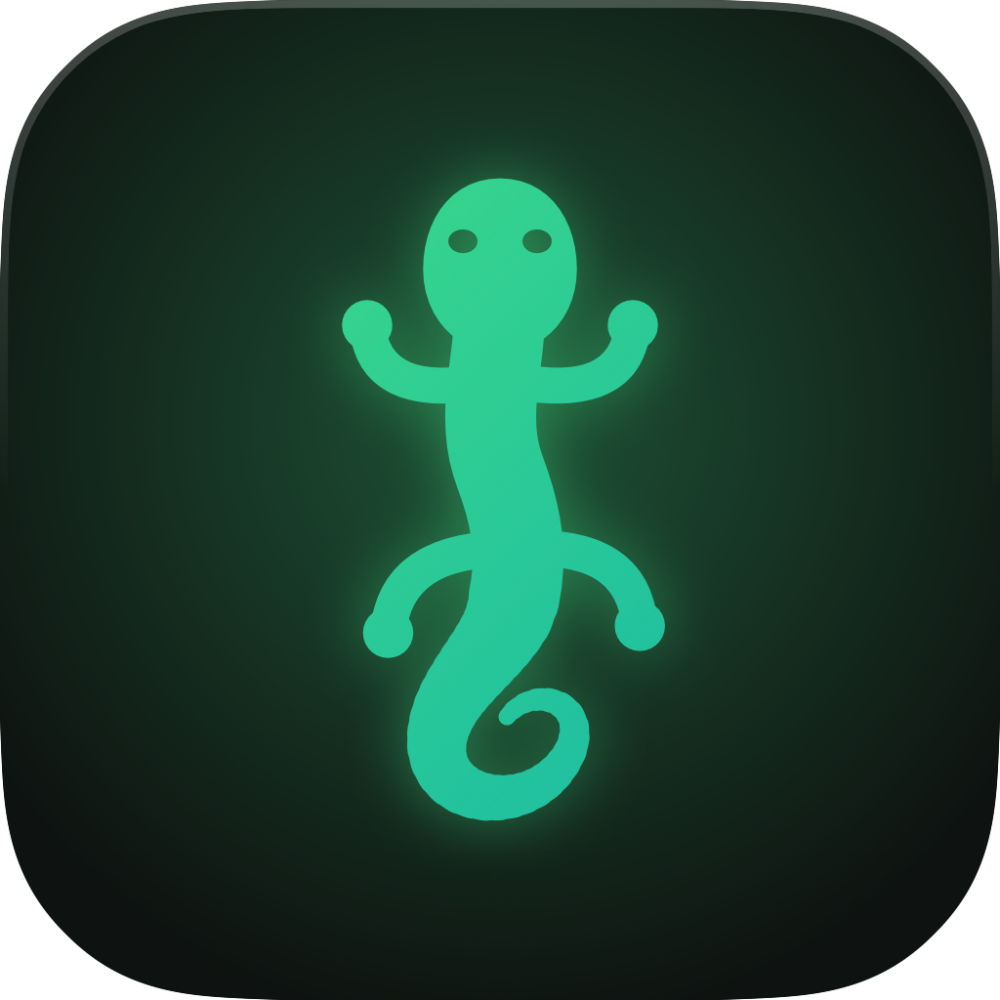
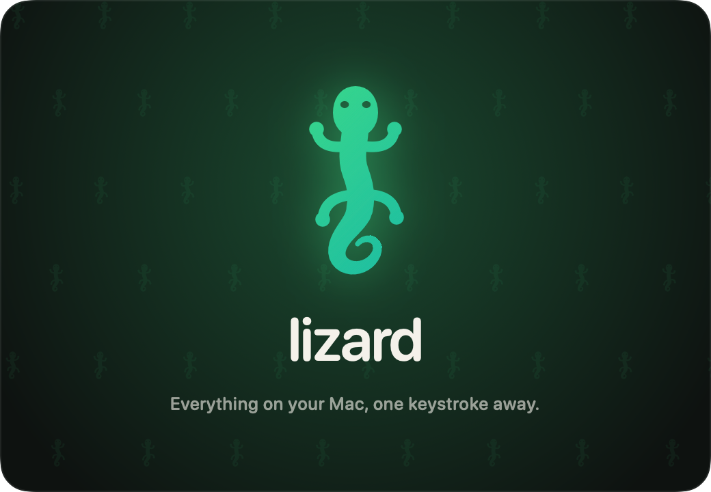

<p align="center">
  
</p>

<h1 align="center">Lizard</h1>

<p align="center">
  A fast, private launcher for macOS — apps, notes, clipboard, AI and Raycast extensions, one keystroke away.<br>
  Native Swift. Local AI by default. No subscription.
</p>

<p align="center">
  
</p>

---

## What it does

Press **⌃Space** anywhere and start typing.

| | |
|---|---|
| **Launcher** | Fuzzy search across apps, commands, quicklinks and extensions (`vsc` → Visual Studio Code). Ranks what you use often and recently first. The panel never steals focus from the app you're in. |
| **Quicklinks** | URL templates with `{query}`, `{clipboard}` and `{selection}`. Type `gh lizard` to search GitHub, `so swift actors` for Stack Overflow, or `code ~/projects/x` to open a folder in VS Code. |
| **Ask AI** | Press **Tab** in the launcher (or **⌥⇧A**) to chat. Answers render as Markdown with code blocks; you can stop a reply mid-stream, and chats are saved. |
| **AI actions** | Summarize or explain your clipboard, summarize today's or this week's work log, or write a **brag document** from the last 90 days of work. |
| **Notes** | Plain Markdown files in `~/Documents/Notes` with folders, `#tags`, pins and live highlighting. **Read mode** puts a copy button on every code block, and a note that's just a command becomes a **snippet**: findable from the launcher, ↩ copies it. The on-device AI suggests a folder and tags. |
| **Search by meaning** | Search notes, work log, clipboard, chats and screenshots by meaning: “that redis timeout thing” finds the note even if those words never appear in it. **Ask Your Notes** answers from them, citing sources. Everything runs on your Mac. |
| **Screenshots** | **⌃⇧S** captures an area. Lizard reads the text (on-device OCR), names and categorizes the image with on-device AI, files it in `Pictures/Lizard Screenshots/<Category>/<Month>/` and copies it. Browse by category and search the text inside your screenshots. |
| **Calculator** | Type math right into the launcher: `15% of 80`, `2^10`, `sqrt(16)+2pi`, `5 km in mi`, `100 f to c`, `2 gb in mb`. |
| **Window management** | **⌃⌥ + arrows** for halves, **⌃⌥↩** to maximize, **⌃⌥C** to center, plus quarters, thirds, next display and restore from the launcher. |
| **Translate** | On-device translation with Apple's Translation framework (private, works offline). Google is an optional fallback. |
| **Work Log** | Press **⌥⇧W**, type what you just finished and press ↩. The entry is stamped with the time and the app you were in, and saved to `~/Documents/WorkLogs/2026-10.md`. |
| **Clipboard history** | Press **⌥⇧V**. Search everything you copied (text, links, files, images); ↩ pastes it into the app you were in. You can pin items. Passwords from password managers are never stored. |
| **Developer tools** | JSON format/minify, JWT decode, Base64, URL encoding, hashes, timestamps, case conversion. **Listening Ports** shows who's on :3000 and lets you stop it. **Kill Process** sorts processes by CPU or memory. |
| **Extensions** | Runs **Raycast extensions** from the Raycast Store or a folder — lists, details, forms, grids, actions and **menu-bar commands**. |
| **GitHub** | Pull requests waiting on you, in the menu bar. Sign in with your browser — no tokens. |

## Install

Requirements: an Apple Silicon Mac on **macOS 26**, Xcode 26.2, [XcodeGen](https://github.com/yonaskolb/XcodeGen),
and **Node.js** (for extensions; `brew install node`).

```sh
git clone <this repo> lizard && cd lizard
xcodebuild -downloadComponent MetalToolchain        # once per machine (local AI)
xcodegen generate
xcodebuild -project Lizard.xcodeproj -scheme Lizard -configuration Release \
  -derivedDataPath DerivedData -destination 'platform=macOS,arch=arm64' -skipMacroValidation build
open DerivedData/Build/Products/Release/Lizard.app
```

On first launch, a short setup walks you through:

1. **Shortcuts** — record your own. The default ⌃Space also switches keyboard input sources if you use several layouts;
   setup warns you about that.
2. **Accessibility** — only needed to paste into other apps.
3. **Folders** for notes and the work log.
4. **AI** — Apple Intelligence, a local model sized for your Mac, or an opt-in cloud.
5. **GitHub** — browser sign-in, then the menu-bar extension.
6. **Try it** — press your shortcut and watch it work.

You can rerun setup any time from the menu-bar icon or the **Run Setup** command.

> Can't see Lizard's menu-bar icons? On MacBooks with a notch and a full menu bar, macOS hides new icons behind the
> notch. Hold ⌘ and drag other icons out of the menu bar, or hide some in System Settings › Menu Bar.

## Private AI

Lizard tries engines in this order, and **nothing leaves your Mac unless you switch on “Allow cloud AI”**:

1. **Apple Intelligence** — Apple's on-device model. Instant, nothing to download.
2. **A local model** running on the GPU through [MLX](https://github.com/ml-explore/mlx-swift). The default is
   **Qwen3 4B** (Qwen3 1.7B on Macs with 16 GB or less). Settings › AI lists bigger models, each with a fit rating for
   your Mac's memory. The model unloads after it's been idle for a while and when memory runs low.
3. **Cloud, opt-in.** Every sign-in happens in the browser:
   - **OpenRouter** (Claude, GPT, Gemini and free models through one OAuth sign-in);
   - **OpenCode Zen** (uses your existing `opencode auth login`);
   - Anthropic and OpenAI keys.
   - Ollama / LM Studio also work as a local server.

## Extensions

Lizard runs extensions written for Raycast. Each command runs in its own Node.js process, using Lizard's own
implementation of the public `@raycast/api` and `@raycast/utils`. The extension's React UI is sent to the app as a view
tree and drawn with native SwiftUI views.

- **No store, no gatekeeping.** Install any extension from GitHub: paste `github.com/owner/repo` (or
  `owner/repo/path@tag`) in Settings › Extensions. Lizard downloads only that folder, pinned to a commit, builds it,
  and **checks for new versions** every few hours. A bare name like `google-translate` installs from Raycast's
  public repo.
- **Build your own** with `lizardcli ext new my-extension`, following [docs/EXTENSIONS.md](docs/EXTENSIONS.md)
  (written for people and AI agents). `lizardcli ext validate` checks your extension against the guidelines.
- **Share** an extension with a friend as a `.lizardext` file. It contains the code only, none of your data.
- Anything not made by Lizard is labelled **External**, and Lizard asks before installing it. External extensions
  aren't reviewed and run with your permissions.
- **Menu-bar commands** become real menu-bar items and refresh on their schedule.
- **Built-in extensions** are written from scratch for Lizard. Nothing is copied from the Raycast repository.

| Extension | Commands |
|---|---|
| Translate | Translate Text, Translate Selection (no API key) |
| Slack | Open favourite channels/people via Slack links (no token) |
| 1Password | Search items; copy username, password or one-time code (1Password CLI + Touch ID) |
| Apple Notes | Search Apple Notes, New Apple Note |
| Warp | Open Warp Here, New Warp Window, Warp Launch Configurations |
| Apple Reminders | Show Reminders, Quick Reminder, Reminders Due Today (menu bar) |
| Kill Process | Kill Process |

**GitHub Review Requests** ([raycast/extensions#29775](https://github.com/raycast/extensions/pull/29775)) is offered by
default. Lizard signs it in through the **GitHub CLI**:

- If `gh` is already installed and signed in, Lizard uses it.
- If not, Lizard downloads GitHub's official CLI into `~/.lizard/gh` and opens GitHub's device sign-in page. The code is
  shown in Lizard and already on your clipboard. Approve in the browser and you're done; no token is created by hand.

Extension sign-in through OAuth (`OAuth.PKCEClient`) isn't supported yet.

## Your data, everywhere

- **iCloud sync** (Settings › Sync & Backup) uses your Apple ID through iCloud Drive. Your quicklinks, settings, shortcuts
  and extension list follow you to every Mac with Lizard, and notes and the work log can live in iCloud Drive › Lizard.
- **Backups:** a `.lizardbackup` file holds everything — extensions with their data, quicklinks, settings, and
  optionally notes and chats.
- **Coming from Raycast:** setup finds your installed Raycast extensions and imports them (they run as they are).
  Quicklinks come over through Raycast's *Export Quicklinks* file.

## Privacy

- Notes and work logs are plain files in your Documents folder. Clipboard history, chats and extension data live in
  `~/Library/Application Support/Lizard`.
- Clipboard history skips items marked concealed or transient (how password managers mark secrets) and copies made in
  1Password, Bitwarden, Keychain Access and Passwords.
- API keys live in one macOS Keychain item.
- Cloud AI is off until you turn it on.

## Developing

- `AGENTS.md` is the technical guide: architecture, conventions, the extension protocol, decisions and pitfalls.
- `docs/PLAN.md` is the roadmap.

```sh
cd Packages/LizardKit && swift test                                 # Swift unit tests
cd Packages/LizardKit/Sources/ExtensionHost/js && npm test           # extension runtime end-to-end tests
Packages/LizardKit/.build/debug/lizardcli ext run <ext> <command>    # run an extension headless
open Lizard.app --args --show-launcher "query"                      # open the launcher without a hotkey
scripts/make-icons.sh                                                # re-render icons from the Swift logo code
```

The project is a SwiftUI/AppKit app (`App/`) on top of a UI-free Swift package (`Packages/LizardKit`). Much of the
architecture comes from Cocoon (the same author's app builder): the AI providers, MLX hosting, process runner and
Keychain handling.

## Roadmap

**Local AI** — ideas that suit a launcher and a small on-device model:

- ~~Semantic search~~ and ~~Ask your notes~~ — done.
- **Natural-language commands** — "kill whatever is on 3000", "open the PR I was reviewing yesterday", "new note from
  clipboard". Apple Intelligence classifies the request into a typed Lizard action (guided generation) and shows a
  confirmation before running it.
- **Selection actions** — select text in any app, then explain, fix grammar, translate, make concise, or write a reply
  in place.
- **AI for extensions** — `AI.ask` already routes to the local model; add `useAI` streaming and a per-extension
  privacy switch.
- **Smarter work log** — automatic tags (`AppleIntelligence.workTags`), daily stand-up drafts, weekly reports, and a
  brag doc that groups work by project and impact.
- **Clipboard intelligence** — detect JSON, JWTs, stack traces, SQL and URLs and offer the right action (format, decode,
  explain, open).
- **Screenshot → text → answer** — OCR with Vision, then explain or translate the text locally.
- **Commit messages and PR summaries** — from `git diff`, on device, piped into the GitHub extension.
- **Voice** — push-to-talk dictation into the launcher or the work log using on-device speech recognition.
- **Snippets with AI fill-in** — templates whose blanks the local model completes from context.
- **Meeting notes** — paste or record a transcript; get decisions and action items as Reminders.

**Platform**

- Notarized releases (Developer ID, hardened runtime, Sparkle updates, bundled Node).
- An extension preferences editor, OAuth for extensions, and background no-view intervals.
- Window management, snippets with text expansion, calculator and unit conversion, emoji picker.

## License

MIT for Lizard's own code. Raycast and GitHub are trademarks of their owners; Lizard isn't affiliated with either.
Extensions installed from the Raycast Store keep their own licenses.
